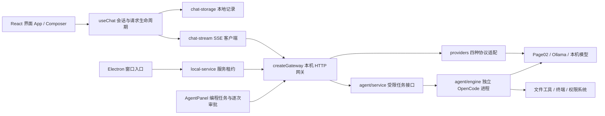

# Strip Bot 架构

当前路由更新：已选择 OpenCode 原生 OpenAI OAuth。统一聊天与编程的新会话使用专用 OpenCode 认证，不经过 CC Switch；桌面版本为 `desktop-app/releases/native-oauth-20261014`。登录及验证范围见 [OPENCODE-OAUTH.md](OPENCODE-OAUTH.md)。以下 CC Switch 说明作为历史记录保留。

2026-10-14 更新：当前界面已统一为聊天与编程共用的 OpenCode 会话。新消息通过 `useUnifiedConversation` → `/api/agent/*` → OpenCode → CC Switch；工具执行、逐次审批、问题表单与文件变更内嵌于消息流。桌面版本为 `desktop-app/releases/unified-chat-20261014`，详见 [UNIFIED-CONVERSATION.md](UNIFIED-CONVERSATION.md)。下文保留早期拆分架构的说明，旧聊天接口仍用于兼容。

已新增可独立启用的 CC Switch 连接：聊天网关与 OpenCode Agent 通过本机 15721 的原生 Responses 路由调用供应商。详见 [CCSWITCH-INTEGRATION.md](CCSWITCH-INTEGRATION.md)。当前桌面快捷方式使用 `desktop-app/releases/ccswitch-20261014` 版本，后文 agent 版本作为上一版保留。

保留 React、Node 和 Electron 的职责划分，并单独接入官方 OpenCode 2.0.28 执行引擎。聊天与编程 Agent 使用各自的会话和请求流程。



## 职责和约定

- `codex-ui/src/domain/chat.ts`：会话类型、协议预设、现有配置迁移。
- `codex-ui/src/state/useChat.ts`：发送、停止、会话管理、重复请求锁、记录保存；界面无需解析 SSE。
- `codex-ui/src/state/chat-storage.mjs`：兼容原存储键，过滤损坏记录，将中断的生成恢复为已停止。保存全部有效历史，容量不足明确提示。
- `codex-ui/src/api/chat-stream.mjs`：`delta/error/done` 契约，处理跨数据块 UTF-8 / CRLF，EOF 不等于成功，退出时释放流。
- `backend/gateway.cjs`：`createGateway({defaults, apiKey, publicDir, requestTimeoutMs})` 返回未监听的 HTTP Server。每个实例独立持有配置和凭证，调用方负责启动、关闭。默认聊天超时 10 分钟。
- `backend/providers.cjs`：OpenAI Chat Completions、Responses、Ollama、普通 JSON 的请求与响应适配；没有进程环境或监听端口依赖。
- `server.js`：兼容原启动脚本的 CLI 入口。只有入口读取环境变量。
- `desktop-app/runtime/local-service.cjs`：桌面服务租约。匹配 Strip Bot 健康标识时复用，否则启动自有网关；只关闭自有服务，端口冲突给出明确提示。
- `desktop-app/runtime/storage-migration.cjs`：限制大小和存储键的旧记录迁移；路径从工作区定位，支持 `STRIPBOT_WORKSPACE_ROOT`，不绑定 G 盘。
- `desktop-app/main.cjs`：窗口、单实例与应用生命周期。验证截图失败不会令产品启动失败。

聊天界面调用 `/api/chat`、`/api/config`、`/api/check`、`/api/models`；编程界面调用 `/api/agent/*` 的明确任务接口。上游 API Key 留在网关和引擎进程环境中，渲染器保持 sandbox、contextIsolation，关闭 nodeIntegration。Agent 接口验证回环 Host 和同来源 Origin，不提供任意命令或代理接口。详见 [AGENT-INTEGRATION.md](AGENT-INTEGRATION.md)。

## 构建和验证

在 `G:\p\Page07` 执行：

```powershell
npm.cmd test
npm.cmd run typecheck --prefix .\codex-ui
powershell -NoProfile -ExecutionPolicy Bypass -File .\scripts\BuildUI.ps1
npm.cmd run package --prefix .\desktop-app
```

UI 构建先发布资源，再更新 HTML 入口。旧资源保留供已打开的窗口使用。`public/build-manifest.json` 列出本次构建资源；桌面打包只纳入当前 UI、backend、runtime、图标和许可，不纳入会话文件、源码备份、旧资源或密钥。

Agent 桌面版本位于 `desktop-app/releases/agent-20261014/Strip Bot-win32-x64/Strip Bot.exe`，桌面快捷方式已指向它。引擎二进制和 MIT 许可随桌面包发布。旧 architecture 版本及 `desktop-app/dist` 保留用于回滚。

修改后需要重启旧的网关进程。端口仍为 3060，上游 Page02 默认为 3010；已打开旧服务不会自动替换它的 Node 代码。

## 备份和回滚

修改前源文件保存在 `.runtime/architecture-before-20261014/`，包含 server.js、package.json、前端 src、桌面入口/打包脚本及 UI 构建脚本。关闭 Strip Bot 和原启动脚本管理的网关，恢复备份文件，然后重新构建 UI 与桌面程序。新增模块可以保留，旧入口不引用它们。记录和 Page02 登录会话未迁移或删除。

## 当前能力

已经接入真实 OpenCode 文件工具、终端执行、逐次权限审批、任务中断和会话历史。确定性模拟模型驱动真实引擎的五次工具操作通过；真实 Page02 模型测试等待 45 秒仍没有返回工具调用或文本，未通过端到端验收。不能据此声称网页模型已具备原生工具调用能力。
